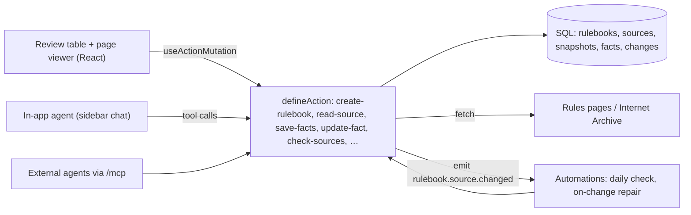

# Rulebook Desk

**Paste a contest, grant or program rules page. An agent turns it into the deadlines and requirements you must meet, and every one of them is pinned to the exact sentence it came from. When the page changes, the facts that no longer hold turn red on their own.**

Built with [Agent-Native](https://www.agent-native.com) for the Builder.io Agent-Native Hackathon (Oct 27 – Nov 9, 2026).

## The problem

Rules pages are long, they change, and the dates are written in someone else's time zone. Missing one line ("the recording must be viewable without a login") or one silent edit (a judging period that moves by two weeks) costs an entry. An LLM summary does not fix this: it can paraphrase a rule that does not exist, and it cannot tell you when the page changed after you read it.

## What it does

| | |
|---|---|
| **Quote-locked facts** | The agent reads the page and proposes each deadline, submission item, requirement, eligibility rule, judging criterion and prize. A fact is saved only if its quote is found verbatim on the fetched page (whitespace, curly quotes and dashes normalized). Invented quotes are rejected by code, not by the model. |
| **Human approval** | New facts start as *proposed*. You approve them in the table next to the page text, with the quoted sentence highlighted. Only facts with a verified quote can be approved. If the agent asks to approve, the app asks you to confirm in chat. If the agent edits a fact you approved, it goes back to *proposed*. |
| **Time math in code** | The agent passes the time exactly as written ("2026-11-09T23:59", "PT"). The app converts it to UTC with `Intl`, then shows your local time, the page's time and UTC side by side. |
| **Drift watch** | "Check pages now" (and a daily automation) re-fetches every page, stores a snapshot when the text changed, shows which paragraphs were added or removed, and marks a fact *stale* when its quote disappeared. A framework event (`rulebook.source.changed`) lets an automation ask the agent to repair stale facts. |
| **Internet Archive replay** | Start tracking from a Wayback Machine copy (the version you read when you entered) and replay later copies to see how the rules changed. |
| **One timeline** | Every tracked deadline across contests on one axis, with countdowns. Requirements become a checklist once approved. |

## Two real runs (no staged data)

1. **Agent-Native Hackathon rules** (`builder.io/hackathon/rules`). The deadline sentence "Monday, November 9, 2026 at 11:59 PM PT" is saved as `dueLocal 2026-11-09T23:59` + `America/Los_Angeles`. Code computes `2026-11-10T07:59Z`, which matches the page's own statement "(November 10, 2026, at 07:59 UTC)". A made-up requirement ("Entries must include a 10-page PDF whitepaper.") was rejected because the sentence is not on the page.
2. **Kiroween 2025 rules** (`kiroween.devpost.com/rules`, Internet Archive copies of 2025-11-18 and 2025-12-12). Between the two copies the judging period end moved from "Monday, January 12, 2026" to "Monday, January 26, 2026". Replaying the later copy turned the saved "Judging ends" fact stale and showed the changed paragraph. The participant counter that also changed ("Participants (2421)" → "(5027)") is filtered out as noise.

## How it uses Agent-Native

Every capability is a `defineAction` in [`actions/`](actions). The React UI calls them through `useActionQuery` / `useActionMutation`; the agent calls the same actions as tools; the CLI (`pnpm action …`) and the auto-mounted MCP endpoint expose them to outside agents such as Claude Code.



- **Shared state, both directions.** The selected row is written to application state (`navigation.factId`, `selection:<tab>`), so "why is this one stale?" in chat refers to the row on screen. Agent writes refresh the table immediately; a row the agent changed flashes.
- **Guardrails live in actions, not prompts.** Quote verification, the approve-only-if-verified rule (also a database `CHECK`), time conversion and access checks run in the action, so they hold for the UI, the agent, automations, CLI and MCP alike.
- **`needsApproval`** gates agent approvals; the UI's own Approve button runs directly.
- **Automations** use the framework scheduler and event bus: a daily `check-sources` job and an event automation on `rulebook.source.changed` whose condition is "staleFactIds is not empty".
- **Write receipts.** `save-facts` returns a `_receipt` with failing checks for rejected quotes, so the agent has to report them honestly.

| Action | What it does |
|---|---|
| `list-rulebooks` | Rulebooks with counts, next deadline and all deadlines for the timeline |
| `get-rulebook` | Sources, facts, recent changes |
| `create-rulebook` / `add-source` | Track 1–5 public URLs (optionally from an Internet Archive date) and fetch them |
| `read-source` | Page text as numbered paragraphs, with a keyword filter |
| `save-facts` | Batch-save quoted facts as *proposed*; rejects quotes not on the page |
| `update-fact` | Patch a fact, approve/reject, tick a checklist item |
| `check-sources` | Re-fetch, diff, mark stale, emit the change event |
| `view-screen` | What the person is looking at: open rulebook and selected fact |

## Run it

Requires Node 22.22+ and pnpm (via corepack).

```bash
corepack enable
pnpm install
pnpm dev            # http://localhost:8080 → "Continue as local dev"
```

The agent needs an AI engine: use **Use Builder.io** in the app's setup, or add an Anthropic/OpenAI/Google key in Settings. Everything except the agent (tracking pages, approving, editing, drift checks, the timeline) works without one.

```bash
pnpm test           # quote matching, diff/noise filter, time-zone math
pnpm typecheck
pnpm agent-native:doctor
```

## What existed before, and what was built during the event

Rules ask entrants to identify pre-existing work. This is an individual entry.

- **Template:** scaffolded on 2026-11-08 with `npx @agent-native/core@0.226.0 create --standalone --template chat` (the Agent-Native Chat starter: app shell, sidebar chat, auth, settings, UI components under `app/components/ui`, layout). Versions are pinned (`@agent-native/core`, `toolkit`, `agentkit` 0.226.0).
- **Libraries:** Agent-Native core/toolkit/agentkit, React 19, React Router, Drizzle ORM, PGlite, Zod, TanStack Query, Tailwind, Radix/shadcn primitives (via the template), Tabler icons, Vitest.
- **Third-party data:** public rules pages fetched at run time; archived copies from the Internet Archive Wayback Machine.
- **Built during the event (all after 2026-10-27, in this repository's history):** everything specific to Rulebook Desk — the database schema and migration, all domain actions, quote verification, paragraph diff and noise filter, time-zone conversion, Wayback replay, the change event and automations, the `/desk` screens (timeline, rulebook cards, review table, page viewer, change banner, edit and add dialogs), navigation/selection state for the agent, the agent instructions, and the tests. Changes to template files are limited to the sidebar link, app name, home path, agent plugin prompt/tool list, `view-screen`, navigation state and styles.
- **Tools:** written with AI coding assistants (Claude Code, Antigravity), reviewed and tested by the author.

## Limits

- Pages that render their text only with client-side JavaScript yield little text; PDFs are not supported yet.
- Quote matching is exact after normalization. A rule split across a table or reworded on the page is reported as unverified rather than guessed.
- Drift is detected per paragraph. A change that keeps every quoted sentence intact (for example a new requirement in a new paragraph) is shown in the diff but does not make an existing fact stale; the repair automation is what proposes new facts.
- Local development stores data in PGlite under `data/`. Scheduled automations do not run on `localhost` unless `AGENT_NATIVE_ENABLE_LOCAL_RECURRING_JOBS=1`; "Check pages now" and "Run now" do.
